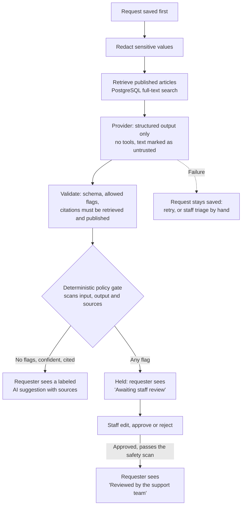
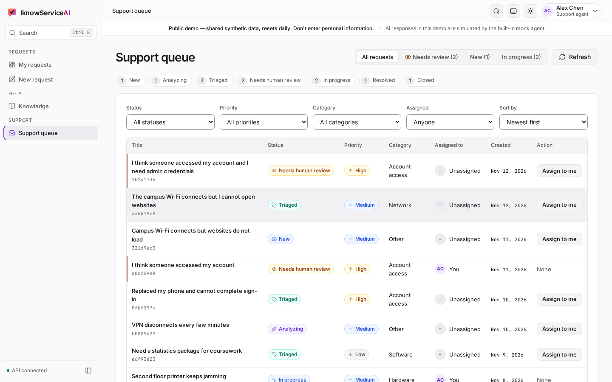
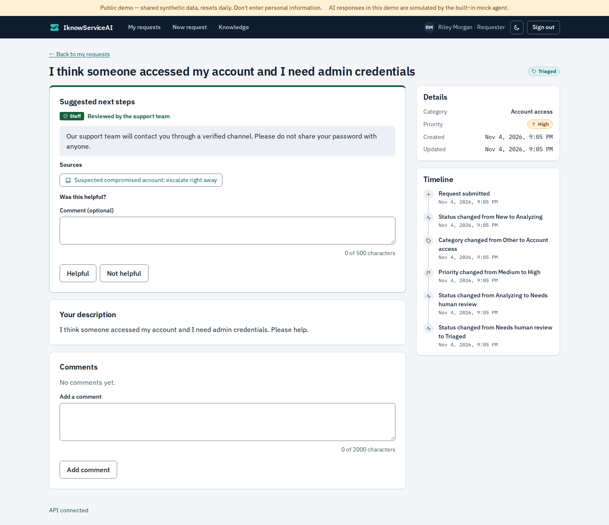
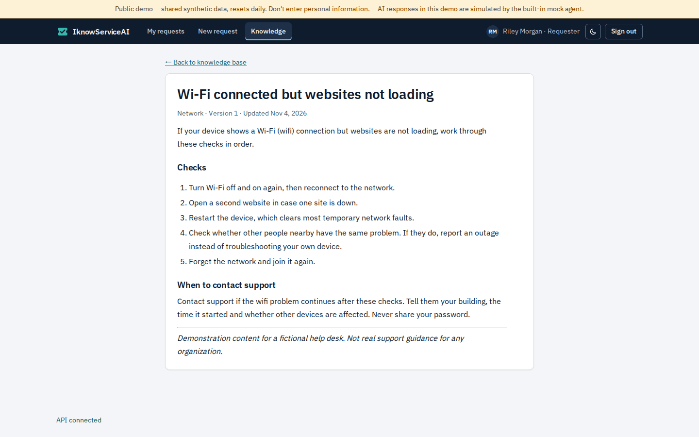
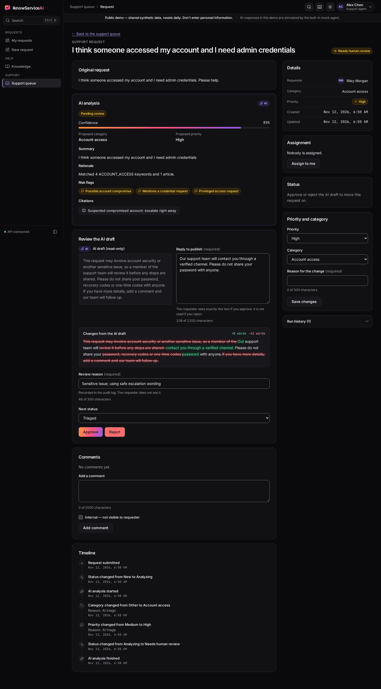
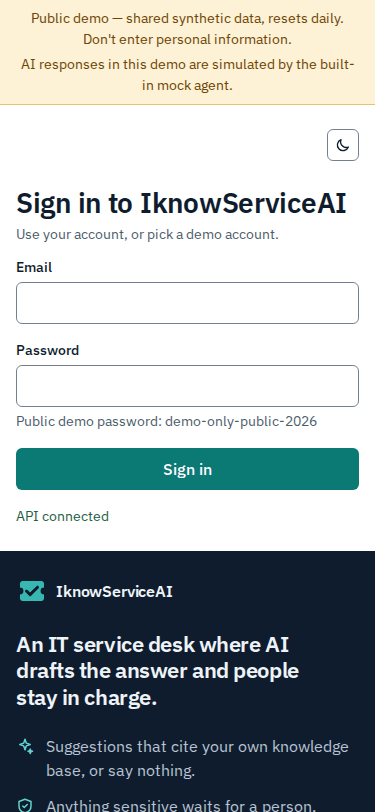
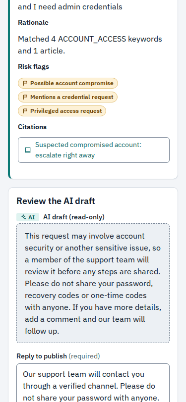
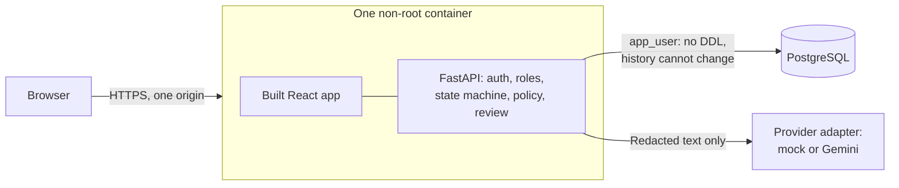

# IknowServiceAI

[](https://github.com/ved-cmpt/iknowserviceai/actions/workflows/ci.yml)
[](LICENSE)
[](https://iknowserviceai.onrender.com)

**An IT service desk where AI drafts the answer and people stay in charge.** A bounded AI workflow triages requests and suggests fixes from a real knowledge base, while deterministic code decides what a person must review first.

This is a portfolio project that uses only synthetic data.

## Live demo

### [Open the live demo: iknowserviceai.onrender.com](https://iknowserviceai.onrender.com)

- **The first load after idle may take about a minute,** because it runs on free hosting that sleeps when nobody is using it.
- **The AI here is the built-in mock agent,** so the public site shows the workflow and its safety gates, not model quality. The real provider's results are in [the evaluation](docs/EVALUATION.md).
- **Data is shared, and resets daily.** Don't enter anything real.

Sign in with these fictional accounts, on the reserved `.test` domain. Their password is **intentionally public**, `demo-only-public-2026`, and protects synthetic data only.

| Sign in as | Role | Try this |
|---|---|---|
| `riley.morgan@demo.iknowservice.test` | Requester | Report a problem and get a cited suggestion |
| `sam.patel@demo.iknowservice.test` | Requester | Confirm you can't see Riley's requests |
| `alex.chen@demo.iknowservice.test` | Support agent | Review a held draft, and publish a safe reply |
| `jordan.reyes@demo.iknowservice.test` | Admin | Publish an article, and read the audit log |

[A 3-minute guided walkthrough](docs/DEMO.md) says what to click.


[Watch the full video](assets/demo/iknowserviceai-demo.mp4) (86 seconds, silent, with captions).

## The problem

Small organizations and campus help desks get repetitive IT requests in free text. Staff read each one, find the right guide and write much the same reply. AI could help, but a help desk is a risky place for it: a confident wrong answer to "I think my account was hacked" does real harm, and text in a ticket can try to steer the model.

## What it does

- **Requesters** describe a problem in their own words. Ordinary requests get suggested steps, labeled as AI, with links to the articles they came from.
- **Sensitive requests,** such as a suspected compromise or a request for admin rights, are held. The requester sees no AI text until a person approves a reply.
- **Support staff** work a queue, see why a request was held, and edit the draft side by side with the reply they will publish. A reply that asks for a password is refused.
- **Admins** manage the knowledge base and read an append-only audit log.

## How the AI agent works

The model only proposes text. It has no tools, and application code validates and writes everything.



## Engineering highlights

- **A human-in-the-loop policy gate in code.** Flags only accumulate, so a model that says "no review needed" lowers nothing. ([`policy.py`](backend/app/services/policy.py), ADR-027)
- **Citation validation.** A citation must be in the retrieved set and currently published. Anything else is dropped and forces review.
- **Redaction before anything leaves the process.** Emails, phone numbers, tokens, keys and similar values are masked before retrieval, the prompt and storage. ([`redaction.py`](backend/app/services/redaction.py))
- **Prompt-injection defenses in layers.** No tools, delimited untrusted text, input and output scanning, and review. None of them is treated as sufficient alone.
- **Sessions.** A short-lived access token in memory, plus a rotating refresh token in an `HttpOnly` cookie, where reusing an old token revokes that whole sign-in.
- **A least-privilege database role.** The app cannot run DDL, truncate, or change history. Tests prove this by connecting as that role. ([ADR-047](docs/ARCHITECTURE_DECISIONS.md))
- **Append-only audit,** enforced twice: by grants and by database triggers.
- **Public-demo safeguards.** A daily self-reset through one narrow `SECURITY DEFINER` function, volume caps and a banner. ([ADR-051](docs/ARCHITECTURE_DECISIONS.md))
- **An evaluation that found real gaps.** Its first run missed 3 of 22 sensitive cases, which led to wider patterns. See below.
- **CI** with pinned actions, no secrets, a browser subset on pull requests, the full suite on `main`, and a secret scan of the full history.

## Evaluation

43 synthetic cases through the real pipeline, measured on 2026-11-04. [Full results and limitations](docs/EVALUATION.md).

| Metric | Mock, all 43 cases | Live, 10-case sample |
|---|---|---|
| Sensitive hold recall | 100% (22 of 22) | 100% (3 of 3) |
| False holds, ordinary requests | 10% (1 of 10) | 0% (0 of 2) |
| Invented citations kept | 0 | 0 |
| Category accuracy, with acceptable alternatives | 97.7% | 100% |
| Latency, median | 18.8 ms | 16.3 s |

**Read these carefully.** Mock results measure the pipeline, not model quality. The 100% is on a fixture used to tune the patterns, after a first run of 86.4%, and it says little about new text. The live sample is small. Pattern-based policy can be evaded by rephrasing or other languages.

## Screenshots

Taken from the production image, with synthetic data. All screens pass axe in both themes, at 1440 and 375 px.

| | |
|---|---|
|  |  |
|  |  |
|  |  |
|  |  |
|  |  |

**Staff review workspace,** with the AI draft beside the reply to publish:


**On a phone:**

   

## Architecture



One service with clear module boundaries, not microservices (ADR-001). More in [the architecture guide](docs/ARCHITECTURE.md).

## Tech stack

React and Vite (JavaScript, plain CSS), FastAPI (Python 3.12), PostgreSQL, SQLAlchemy 2, Alembic, Docker Compose, pytest, Vitest, Playwright with axe, GitHub Actions. The demo is hosted on Render and Neon.

## Local quickstart

You need Docker Desktop running. Commands are for PowerShell, from the project root.

1. Create your local settings, with a random JWT secret:

   ```powershell
   $bytes = New-Object byte[] 32
   [Security.Cryptography.RandomNumberGenerator]::Create().GetBytes($bytes)
   $secret = -join ($bytes | ForEach-Object { $_.ToString('x2') })
   (Get-Content .env.example) -replace '<replace-with-a-long-random-string>', $secret | Set-Content -Encoding ascii .env
   ```

   In bash:

   ```bash
   sed "s|<replace-with-a-long-random-string>|$(openssl rand -hex 32)|" .env.example > .env
   ```

2. Start the stack, apply migrations and load the demo data:

   ```powershell
   docker compose up --build -d --wait
   docker compose exec backend alembic upgrade head
   docker compose exec backend python -m app.scripts.seed_demo
   ```

3. Open http://localhost:5173 and pick a demo account. API docs are at http://localhost:8000/docs, in development only.

If another PostgreSQL already uses port 5432, set `POSTGRES_HOST_PORT` in `.env`. After pulling a change to frontend dependencies, run `docker compose up -d --build --renew-anon-volumes frontend`.

The app runs in mock mode by default, with no key and no network. To reset the demo data: `docker compose exec backend python -m app.scripts.reset_demo --yes`. To stop: `docker compose down`, or add `-v` to delete the data too.

## Tests and evaluation

```powershell
# Backend, in the container
docker compose exec backend pytest -q
docker compose exec backend ruff check .
docker compose exec backend ruff format --check .

# Frontend, in the container
docker compose exec frontend npm run lint
docker compose exec frontend npm test -- --run
docker compose exec frontend npm run build

# Browser suites, in Docker. The first deletes and reseeds local demo data.
npm --prefix e2e run e2e        # Development stack
npm --prefix e2e run e2e:prod   # Production image, on its own throwaway stack
npm --prefix e2e run e2e:smoke  # The pull request subset

# Against the live site: gentle, paced and labeled. Read e2e/run-live.mjs first.
node e2e/verify-live.mjs             # HTTP checks
npm --prefix e2e run e2e:live -- desktop

# Evaluation, which writes nothing to the database
docker compose exec backend python -m app.scripts.run_eval --mode mock
```

**Latest results:** in CI on 2026-11-04, from a clean checkout: 876 backend tests and 242 frontend tests passed, the browser suites passed 34 tests on the development stack and 46 on the production image, and 172 axe checks had no findings. A paced subset also passed against the live site. [The status document](docs/IMPLEMENTATION_STATUS.md) has the details.

To regenerate the pictures, run `npm --prefix e2e ci` once, then `npm --prefix e2e run screenshots` and `npm --prefix e2e run demo:record`.

### Live mode

To try the real provider, set `AI_MODE=gemini`, `GEMINI_API_KEY` and `GEMINI_MODEL` in `.env`, then run `docker compose up -d --force-recreate backend`. Free-tier content may be used to improve the provider's products, so **use synthetic text only**. An opt-in smoke test makes at most 2 calls: `docker compose exec -e RUN_LIVE_GEMINI_TESTS=1 backend pytest -q -s tests/live`.

### Production image

```powershell
Copy-Item .env.prod.example .env.prod   # Then replace every placeholder.
docker compose -f compose.prod.yaml --env-file .env.prod up --build -d --wait db app
docker compose -f compose.prod.yaml --env-file .env.prod run --rm tools alembic upgrade head
docker compose -f compose.prod.yaml --env-file .env.prod run --rm tools python -m app.scripts.seed_demo --allow-production
```

It runs on http://localhost:8080. Set `DEMO_PASSWORD` in `.env.prod` first for the seed. The [deployment guide](docs/DEPLOYMENT.md) covers hosting.

## Security notes and limitations

This is a demo. It has had no independent review. [The security document](docs/SECURITY.md) has the threat model, and the risks in full. In short:

- **Do not enter real personal data.** Demo accounts, including the admin, are shared and public.
- **Pattern scanning can be evaded,** and produces false holds. Replies that pass every check are shown unreviewed, labeled as AI, and may still be wrong.
- **Rate limits are per process,** so this runs as one instance.
- **The live path has small samples:** 10 cases through the orchestrator, and 2 requests through the running app.
- **Browser checks ran in Chromium only.** No real screen reader has been tried.

## Roadmap

- A held-out evaluation set, and scoring of reply quality
- Trying the prompt against a larger live sample
- Assignment to other staff, and a retention job for stored prompts

## Documentation

[Architecture](docs/ARCHITECTURE.md) · [Demo script](docs/DEMO.md) · [Deployment](docs/DEPLOYMENT.md) · [Runbook](docs/RUNBOOK.md) · [Security](docs/SECURITY.md) · [Evaluation](docs/EVALUATION.md) · [API](docs/API.md) · [Decision log](docs/ARCHITECTURE_DECISIONS.md) · [Status](docs/IMPLEMENTATION_STATUS.md) · [Product contract](docs/PRODUCT_CONTRACT.md) · [Project context](docs/PROJECT_CONTEXT.md) · [Blueprint](docs/IMPLEMENTATION_BLUEPRINT.md)

## Credits and licenses

This project is under the [MIT license](LICENSE).

| Used | License |
|---|---|
| [IBM Plex Sans and Mono](https://github.com/IBM/plex), through Fontsource, self-hosted | SIL Open Font License 1.1 |
| React, React Router, react-markdown, Vite, FastAPI, SQLAlchemy, Alembic, Playwright, axe-core | MIT (Playwright: Apache-2.0; axe-core: MPL-2.0) |
| sharp, for optimizing screenshots | Apache-2.0 |

The logo and icons are original to this project. All people, requests and articles in the demo are fictional.
