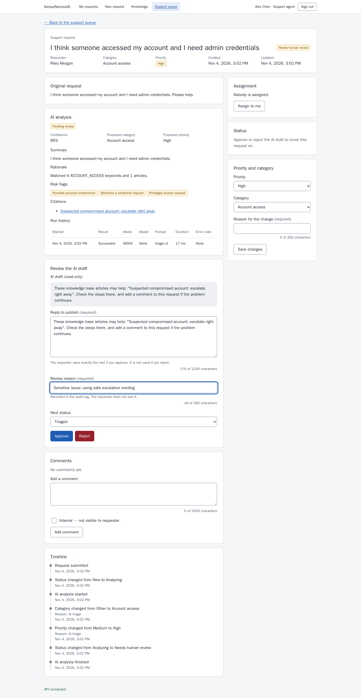
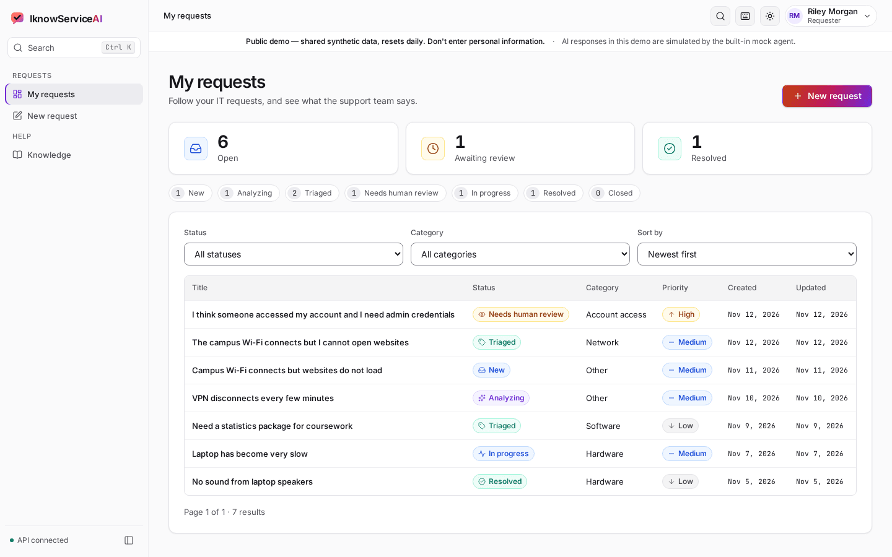
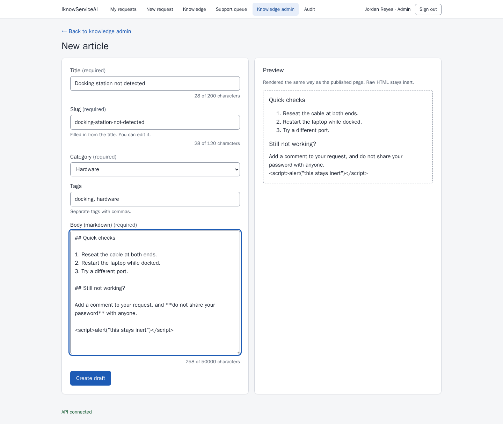
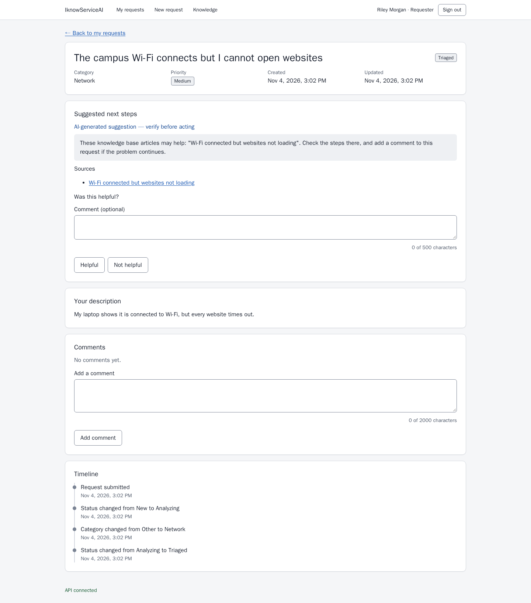
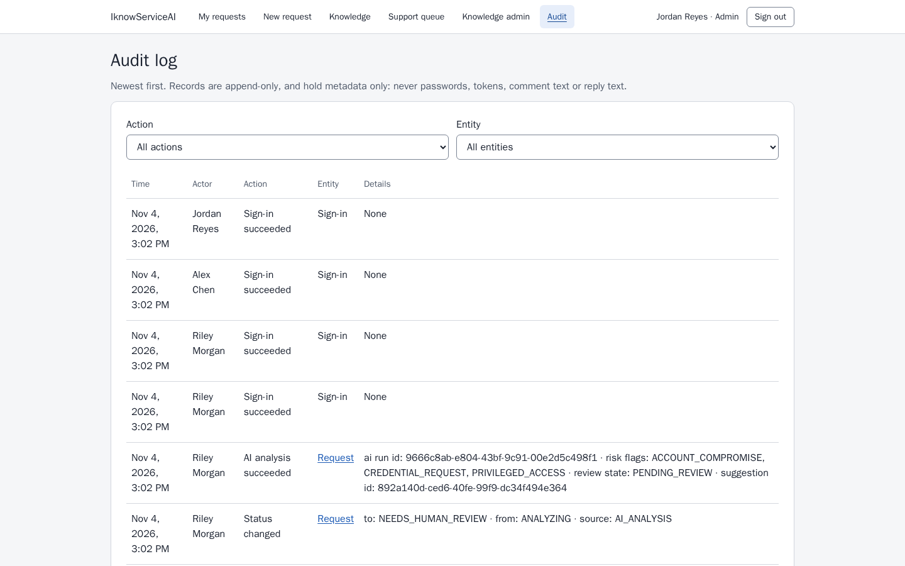
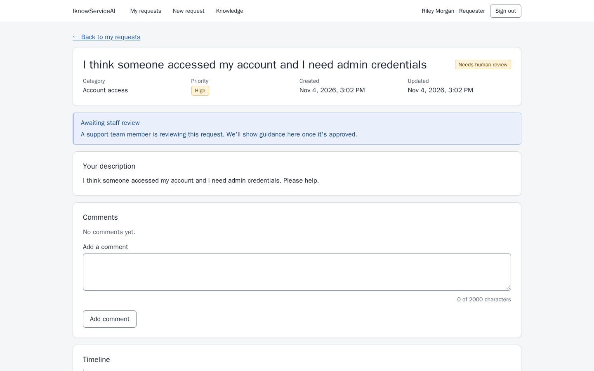
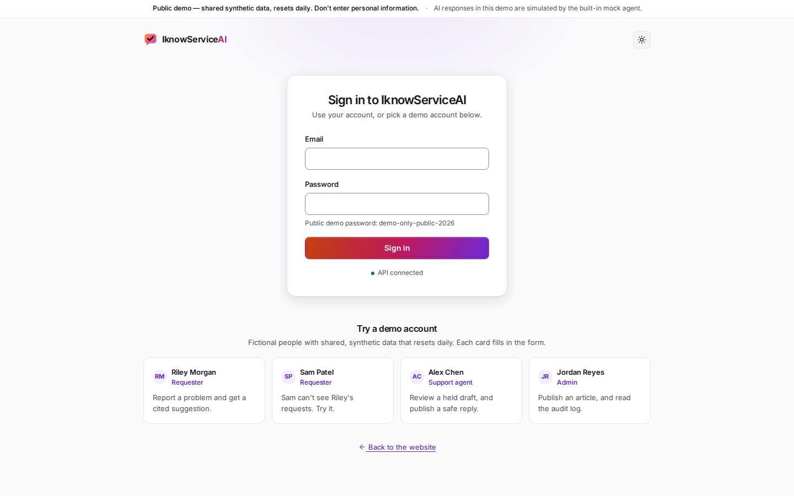
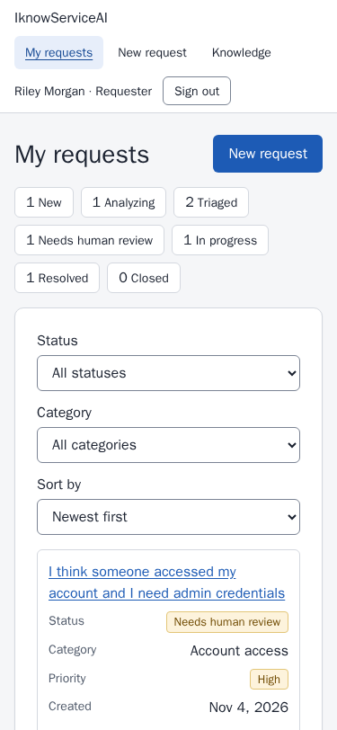
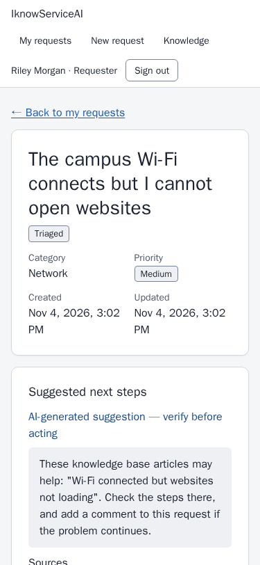

# IknowServiceAI

An AI-assisted IT service-request platform with knowledge-grounded suggestions and human review gates. This is a portfolio project that uses only synthetic data.

**Status: complete locally, in mock mode, for requesters, support staff and admins.** Nothing is deployed and there is no CI yet. Live Gemini passed one owner-run smoke test of the adapter, but has not been run through the whole app. See [implementation status](docs/IMPLEMENTATION_STATUS.md) for verified progress.



## Features

- [x] Docker Compose stack with health and readiness checks
- [x] Sign-in with Argon2id passwords and short-lived JWTs, plus USER, AGENT and ADMIN roles
- [x] Full database schema, Alembic migrations, idempotent synthetic seed and guarded reset
- [x] Request lifecycle: filters, comments, state machine, optimistic concurrency, events and audit
- [x] Knowledge base: PostgreSQL full-text search, retriever for the AI workflow, safe markdown rendering
- [x] AI triage with a deterministic mock agent, redaction, citation checks and retry limits
- [x] Deterministic policy gate, staff review, feedback, rate limiting and adversarial tests
- [x] Live Gemini adapter, with one passing owner-run smoke test
- [x] Requester screens: dashboard, new request, automatic analysis, labelled suggestion, citations, feedback, comments, timeline
- [x] Staff screens: queue with filters and assignment, review workspace, status and priority controls, internal comments
- [x] Admin screens: knowledge editor with safe preview, publish and unpublish, audit log
- [x] Playwright E2E, axe accessibility checks and a 375 px mobile pass, all in mock mode
- [ ] Evaluation, CI and hosted demo

## Screenshots

| Requester | Support and admin |
|---|---|
|  |  |
|  |  |
|  |  |

 

## Stack

React and Vite (JavaScript), FastAPI (Python 3.12), PostgreSQL 17, SQLAlchemy 2, Alembic, Docker Compose, pytest, Vitest, Playwright.

## Quickstart

You need Docker Desktop running. Commands are for PowerShell, from the project root.

1. Create your local environment file with a random JWT secret:

   ```powershell
   $secret = python -c "import secrets; print(secrets.token_urlsafe(48))"
   (Get-Content .env.example) -replace '<replace-with-a-long-random-string>', $secret | Set-Content -Encoding ascii .env
   ```

   In bash:

   ```bash
   sed "s|<replace-with-a-long-random-string>|$(openssl rand -hex 32)|" .env.example > .env
   ```

2. Start the stack, apply migrations and load the demo data:

   ```powershell
   docker compose up --build -d
   docker compose exec backend alembic upgrade head
   docker compose exec backend python -m app.scripts.seed_demo
   ```

3. Open the app:

   | What | URL |
   |---|---|
   | App | http://localhost:5173 |
   | API docs (development only) | http://localhost:8000/docs |
   | Liveness | http://localhost:8000/healthz |
   | Readiness | http://localhost:8000/readyz |

   The health endpoints are also served at `/api/v1/healthz` and `/api/v1/readyz`.

If another PostgreSQL already uses port 5432, set `POSTGRES_HOST_PORT` in `.env` to a free port.

## Demo accounts

These are fictional accounts on the reserved `.test` domain. They share one **intentionally public** password, `demo-only-public-2026` (`DEMO_PASSWORD` in `.env`), which protects synthetic data only.

| Email | Role | Name | Starts at |
|---|---|---|---|
| `riley.morgan@demo.iknowservice.test` | USER | Riley Morgan | My requests |
| `sam.patel@demo.iknowservice.test` | USER | Sam Patel | My requests |
| `alex.chen@demo.iknowservice.test` | AGENT | Alex Chen | Support queue |
| `jordan.reyes@demo.iknowservice.test` | ADMIN | Jordan Reyes | Support queue |

Reloading the page signs you out, because the token is held in memory only (ADR-009).

## Tests and checks

```powershell
# Backend, in the container
docker compose exec backend pytest -q
docker compose exec backend ruff check .
docker compose exec backend ruff format --check .

# Frontend, in the container
docker compose exec frontend npm run lint
docker compose exec frontend npm test -- --run
docker compose exec frontend npm run build
```

Frontend checks also work on the host with Node 24. Run `npm ci` once in `frontend/`, then use `npm --prefix frontend run lint`, `npm --prefix frontend test -- --run` and `npm --prefix frontend run build`.

Backend tests use the separate `iknowserviceai_test` database and never touch demo data. They use mock and fake providers and make no provider calls.

### Browser E2E

One command runs everything, in Docker, with the browser inside the official Playwright image:

```powershell
npm --prefix e2e run e2e
```

It needs Node on the host only to start `e2e/run.mjs`, and installs nothing there. **It deletes and reseeds the demo data.** It starts the stack with high rate limits and `AI_MODE=mock` from `compose.e2e.yaml`, runs the journeys and axe checks at 1440 px and 375 px, captures the screenshots into `assets/screenshots/`, then restores the default settings and fresh demo data. To run some tests, without screenshots and at desktop size only:

```powershell
npm --prefix e2e run e2e -- --grep "Stale update"
```

### Live Gemini smoke test

This is opt-in, and makes at most 2 API calls:

```powershell
docker compose exec -e RUN_LIVE_GEMINI_TESTS=1 backend pytest -q -s tests/live
```

## Reset the demo data

This deletes all data and reseeds it:

```powershell
docker compose exec backend python -m app.scripts.reset_demo --yes
```

It refuses to run unless `ALLOW_DEMO_RESET=true`, and in `APP_ENV=production` it also requires `--allow-production`.

## AI mode

`AI_MODE=mock` is the default. It is deterministic and uses no network or key.

To try Gemini, set these in `.env`, then recreate the backend:

```dotenv
AI_MODE=gemini
GEMINI_API_KEY=<your key>
GEMINI_MODEL=<a free-tier Flash model>
```

```powershell
docker compose up -d --force-recreate backend
```

Set `AI_MODE=mock` and recreate it again to switch back.

- **Free tier:** each analysis makes up to 2 provider calls, and free-tier quotas are small. One call took about 15 seconds in the only passing test, so an analysis can take over a minute at worst. A request is always saved first, and a failed analysis can be retried or handled by staff.
- **Synthetic data only:** Google's pricing page says free-tier content may be used to improve its products. Text is redacted before sending, but patterns can miss things. **Do not enter real personal data.** See [security](docs/SECURITY.md).
- **What has been verified:** the adapter passed one live smoke test. The whole app has not been run in this mode, so this is a good first thing to watch.

## Useful commands

```powershell
docker compose logs -f backend
docker compose exec backend alembic current
docker compose down        # stop, keep data
docker compose down -v     # stop and delete the database volume
```

## Documentation

- [Project context](docs/PROJECT_CONTEXT.md)
- [Product contract](docs/PRODUCT_CONTRACT.md)
- [API reference](docs/API.md)
- [Architecture decisions](docs/ARCHITECTURE_DECISIONS.md)
- [Security](docs/SECURITY.md)
- [Implementation status](docs/IMPLEMENTATION_STATUS.md)
- [Implementation blueprint](docs/IMPLEMENTATION_BLUEPRINT.md)
- [Latest run report](docs/RUN_REPORTS/RUN_03.md)
