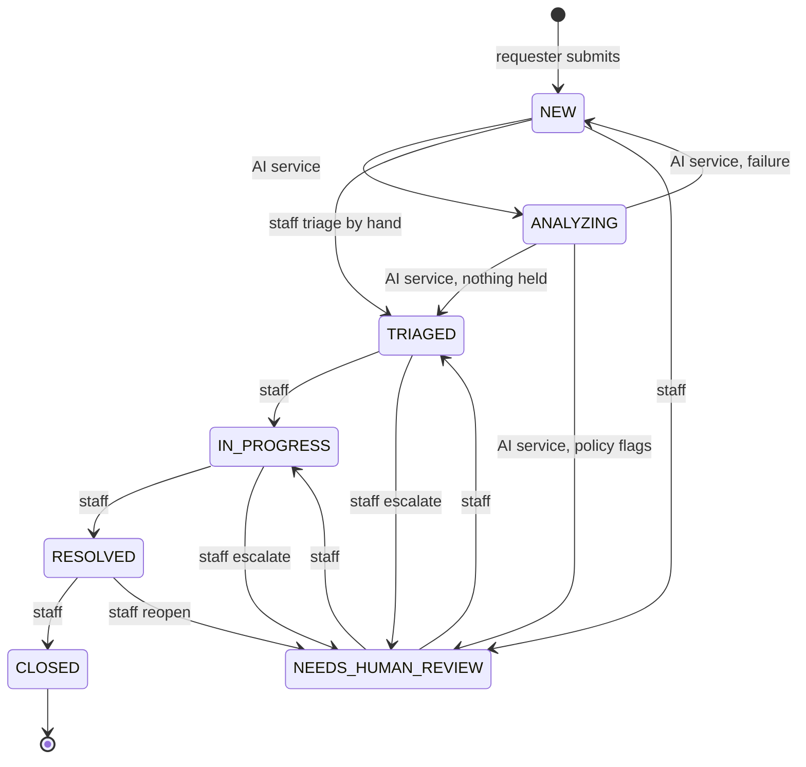
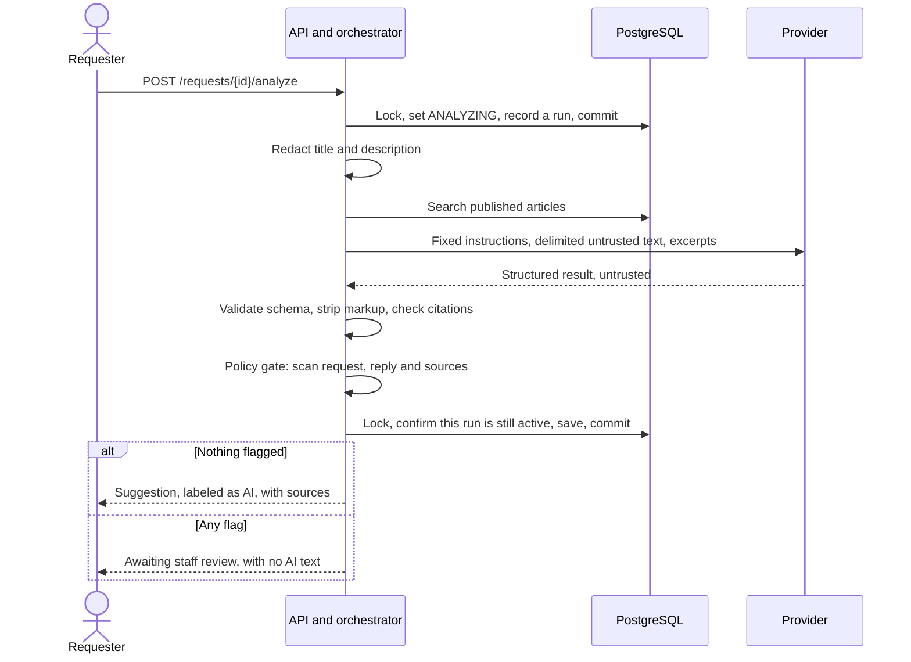
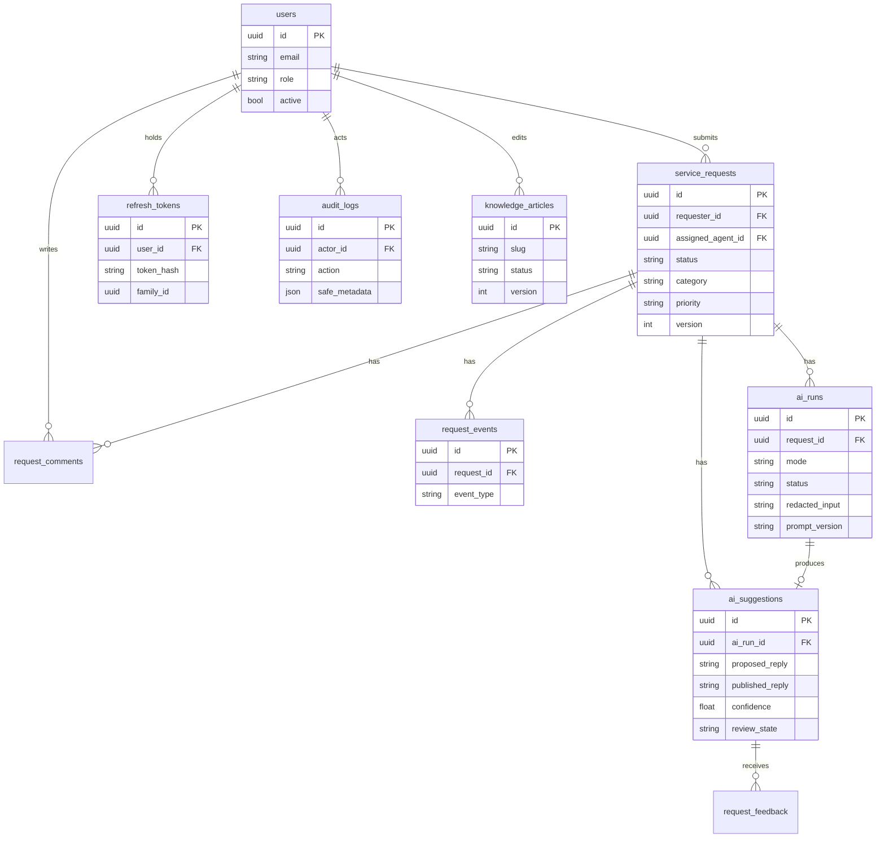
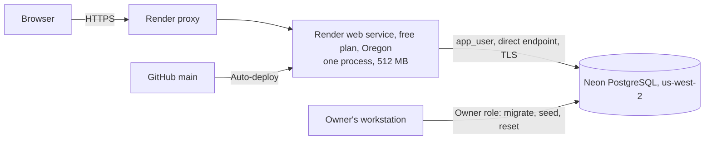

# Architecture

How the system fits together. Why it is built this way is in [the decision log](ARCHITECTURE_DECISIONS.md), and the code is the final word.

## Components

| Part | Where | What it does |
|---|---|---|
| Web app | `frontend/src/` | React and plain CSS. Requester, staff and admin screens. The server decides every permission, and the browser never calls the AI provider |
| API | `backend/app/routers/` | FastAPI routes under `/api/v1`, with explicit schemas for each role |
| Services | `backend/app/services/` | The state machine, policy gate, review, redaction, retrieval and demo safeguards. All decisions are made here |
| Provider adapter | `backend/app/services/ai/` | A mock agent and a Gemini adapter behind one interface, plus the orchestrator |
| Database | PostgreSQL | Migrated by Alembic as the owner. The app connects as `app_user` |
| Production image | `deploy/Dockerfile` | One non-root container serving the built frontend and the API on one origin |
| Browser tests | `e2e/` | Playwright with axe, run in Docker against both stacks |

## Request lifecycle

All rules are in [`state_machine.py`](../backend/app/services/state_machine.py). Only the AI service may enter or leave `ANALYZING`.

## AI workflow

The analysis has two short transactions, with no lock held during the provider call (ADR-026).

If the provider fails, the request returns to `NEW`, and the requester can retry within the attempt limit, or staff can triage it by hand. A late result from a replaced run is refused.

## Data model

Simplified. `demo_state` is a separate one-row table that holds the reset switch. `audit_logs.entity_id` has no foreign key, because history must outlive what it describes.

`request_events` and `audit_logs` are append-only, by grants and by triggers (ADR-025, ADR-047).

## Deployment topology

The service sleeps when idle, and so does the database. Neither is a problem by design: health checks use `/healthz`, which has no dependencies, the connection pool replaces dead connections, and the demo resets itself on the first API request after the interval (ADR-051 to ADR-053). See [the deployment guide](DEPLOYMENT.md).
