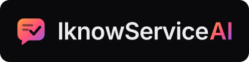

# Brand

IknowServiceAI's identity, and how to rebuild it. Everything here is original to this project. The shapes live in one file, [`scripts/brand/build.mjs`](../scripts/brand/build.mjs), and every asset is generated from it.

## The idea

**AI drafts, people approve.** The mark is a reply card with a speech tail. Two short lines are the AI's draft, and the check is the person who approved it. The product's whole promise fits in one shape: a suggestion is only a draft until someone with the authority says yes.




## Assets

| File | Use |
|---|---|
| [`assets/brand/mark.svg`](../assets/brand/mark.svg) | The mark, on a 64 x 64 grid. From 40 px up |
| [`assets/brand/mark-small.svg`](../assets/brand/mark-small.svg) | The small mark, on a 32 x 32 grid: the card and the check only, with a heavier stroke. From 16 to 32 px |
| `assets/brand/wordmark-dark.svg`, `wordmark-light.svg` | The wordmark, as outlines, for dark and light backgrounds |
| `assets/brand/lockup-dark.svg`, `lockup-light.svg` | Mark and wordmark on their own background |
| `assets/brand/lockup-on-dark-transparent.svg`, `lockup-on-light-transparent.svg` | The same, with no background |
| `assets/brand/app-icon.svg`, `app-icon-maskable.svg` | App icons. The maskable one keeps the mark inside the central 80% circle that a platform may crop to |
| `assets/brand/og-image.svg` | The source of the Open Graph image |
| `frontend/public/favicon.svg` | The small mark, for browsers that read SVG icons |
| `frontend/public/favicon.ico` | 16, 32 and 48 px, as PNG images inside one ICO file |
| `frontend/public/icons/apple-touch-icon.png` | 180 px |
| `frontend/public/icons/icon-192.png`, `icon-512.png`, `icon-maskable-512.png` | Listed in `site.webmanifest` |
| `frontend/public/og-image.png` | 1200 x 630, for link previews |

## Rebuilding

```powershell
npm --prefix scripts/brand ci
npm --prefix scripts/brand run build
```

It needs no font installed: text becomes outlines with Inter, from `@fontsource/inter`. It uses `opentype.js` (MIT) and `sharp` (Apache-2.0), installed in `scripts/brand/` only.

## Construction

- **Mark, 64 grid:** a card from (6, 8) to (58, 50) with a 12-unit corner radius, and a tail that leaves the bottom edge at x = 27 and ends at about (14, 57). The draft lines are 4.2 units thick at 50% opacity, and the check is 5 units.
- **Small mark, 32 grid:** the same card at half scale, without the draft lines, whose detail turns to noise below 32 px. The check is 3.4 units, so it stays legible at 16 px.
- **Clear space:** at least the height of the check on every side.
- **Minimum size:** 16 px for the small mark, 40 px for the full mark, and 96 px wide for a lockup.

## Color

| Name | Value | Used for |
|---|---|---|
| Amber | `#FF9A3C` | Start of the Ember gradient |
| Rose | `#FF4F7B` | Middle of the gradient |
| Violet | `#8B5CF6` | End of the gradient |
| Ink | `#140A1C` | The check and lines on the mark, and text on the gradient |
| Night | `#0A0A0C` | The dark background, and app icons |

**Ember,** the gradient from amber through rose to violet, is the signature. It is kept for the mark, primary actions and a few headline words, and is never used to signal a status. On the dark theme, primary buttons put ink text on the bright gradient. On the light theme, they use a darker version, `#C2410C` to `#BE185D` to `#6D28D9`, under white text. Both pass WCAG AA at every point along the gradient.

**Interface colors** are semantic tokens in [`frontend/src/styles/tokens.css`](../frontend/src/styles/tokens.css). Violet is the interactive accent: links, selection and focus. Green, red, amber and blue mean pass, fail, warning and info, and nothing else.

It is deliberately warm. It shares nothing with the lime, emerald and cyan used by the author's other project.

## Type

- **Inter,** variable, for the interface and the website. Its tight, even shapes suit dense tables and large headlines alike.
- **JetBrains Mono** for IDs, dates, code and keyboard keys.

Both are under the SIL Open Font License 1.1, self-hosted, Latin only, and loaded with `font-display: swap`. The Inter file is preloaded. A fallback face sized to Inter's metrics keeps text from jumping when it arrives.

The wordmark is Inter SemiBold with -2% tracking. "AI" takes the gradient, because AI is the part people should notice and check.

## Voice

Plain, specific and honest. Say what the product does in v1 as built, and show where each number comes from. No customer logos, testimonials, user counts, prices or awards, because there are none.

## Don't

- Recolor the mark outside the Ember gradient, or put it on a busy image.
- Use the gradient for status, warnings or errors.
- Stretch, rotate, outline or add effects to the mark.
- Set the wordmark in another typeface.
