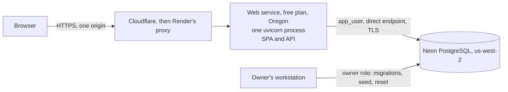

# Deployment

The public demo is one Render web service in front of one Neon PostgreSQL database. The service runs the production image from `deploy/Dockerfile`, in mock mode. **It is live at https://iknowserviceai.onrender.com,** and was verified on 2026-11-04. The results are below.



The running service only ever holds the `app_user` connection. The owner connection stays on the workstation (ADR-047).

## Free-tier limits

Read from the providers' docs on 2026-11-04. Check again before relying on them.

| Provider | Limit | What it means here |
|---|---|---|
| Render | 512 MB, 0.1 CPU | One process only |
| Render | Spins down after 15 idle minutes, and takes about a minute to start | The first visitor after a quiet spell waits |
| Render | 750 free instance hours a month, per workspace | Spun-down time does not count |
| Render | Health check must answer within 5 seconds. A deploy is cancelled after 15 minutes without passing | Uses `/healthz`, which has no dependencies (ADR-053) |
| Render | No persistent disk, shell or one-off jobs on the free plan | The app writes nothing to disk. Migrations run from a workstation |
| Neon | Suspends after 5 idle minutes, which cannot be disabled | The next query wakes it, which adds delay |
| Neon | 100 compute-unit hours a month per project, 1 GB of storage | Far more than this demo needs |
| Neon | Instant restore up to 6 hours back, limited to 1 GB of change history, and 1 manual snapshot | Demo data can be recreated anyway |

A cold visit can wait for both. One measurement is under [verified results](#verified-results). Render's own figure is about a minute, so the README promises that.

## Environment variables

Non-secret values are in [`render.yaml`](../render.yaml).

| Variable | Secret | Value on the demo |
|---|---|---|
| `DATABASE_URL` | **Yes** | `app_user` connection, from `.env.render` |
| `JWT_SECRET` | **Yes** | Random, from `.env.render` |
| `GEMINI_API_KEY` | **Yes** | Empty in mock mode |
| `APP_ENV` | No | `production` |
| `DEMO_MODE` | No | `true` |
| `DEMO_PASSWORD` | No, published on purpose | Must match the value the database was seeded with |
| `AI_MODE`, `GEMINI_MODEL` | No | `mock`, and a model name that mock mode ignores |
| `CORS_ALLOWED_ORIGINS` | No | The Render URL. The app is same-origin |
| `TRUSTED_PROXY_HOPS` | No | `3`, measured on the live site (ADR-061) |
| `FORWARDED_ALLOW_IPS` | No | `*`, on Render only (ADR-052) |
| `HSTS_ENABLED` | No | `true` |
| `ACCESS_TOKEN_MINUTES`, `REFRESH_TOKEN_HOURS` | No | `10`, `8` |
| `RATE_LIMIT_LOGIN_PER_MINUTE`, `RATE_LIMIT_ANALYZE_PER_HOUR`, `RATE_LIMIT_REFRESH_PER_MINUTE` | No | `5`, `10`, `60` |
| `DEMO_RESET_INTERVAL_HOURS` | No | `24` |
| `DEMO_MAX_REQUESTS_PER_ACCOUNT_PER_DAY`, `DEMO_MAX_REQUESTS_TOTAL`, `DEMO_MAX_ARTICLES` | No | `20`, `300`, `30` |
| `LOG_LEVEL` | No | `INFO` |

**Never give the service `MIGRATION_DATABASE_URL`** or the owner connection.

## Provisioning the database

The free plan has no pre-deploy command, so this runs from a workstation, with Docker. Put the owner connection in the git-ignored `.env`, as `NEON_OWNER_DATABASE_URL`. Use the direct endpoint, whose host has no `-pooler` (ADR-052). Then, in PowerShell:

```powershell
docker build -f deploy/Dockerfile -t iknowserviceai:local .
docker run --rm -v "${PWD}:/work" iknowserviceai:local python /work/deploy/neon/provision.py
```

[`deploy/neon/provision.py`](../deploy/neon/provision.py) does the following, and prints only versions, names, counts and pass or fail:

1. Checks the connection.
2. Creates `app_user` with a generated password, or rotates it if it exists. The role is created by SQL, so it is not in `neon_superuser`.
3. Runs `alembic upgrade head` as the owner, applies `deploy/sql/grant_app_role.sql`, and runs `alembic check`.
4. Seeds the demo data twice, which shows that the seed can safely repeat.
5. Enables the daily reset on this database, with `deploy/sql/enable_demo_reset.sql`.
6. Connects as `app_user`, to confirm what it may and may not do, then runs the real reset as that role.
7. Writes `.env.render`, and adds `NEON_APP_DATABASE_URL` to `.env`. Both are git-ignored.

**A repeat rotates the database password and JWT secret,** so paste `.env.render` into Render again afterwards, or the service loses its database.

## Deploying on Render

The steps are in `docs/RUN_REPORTS/RUN_05.md`, under "What the owner must do in Render". In short: New, Blueprint, this repository, then paste `.env.render` using **Add from .env**.

## Later deploys

1. **Migrate first,** from a workstation, as the owner. The old version keeps running during a deploy, so a migration must work with it:

   ```powershell
   docker build -f deploy/Dockerfile -t iknowserviceai:local .
   docker run --rm --env-file .env.neon-migrate iknowserviceai:local alembic upgrade head
   ```

   `.env.neon-migrate` is a git-ignored file you create, with `DATABASE_URL`, `MIGRATION_DATABASE_URL` and `JWT_SECRET`. Delete it afterwards.

2. Push to `main`. Render deploys it (`autoDeploy`).
3. Check `/readyz`. It returns 503 with `"migrations": "behind_head"` if step 1 was missed.

A new table needs adding to `demo_reset_begin` in its own migration. A test fails until it is (ADR-051).

## Demo safeguards

All need `DEMO_MODE=true` (ADR-051):

- **Daily reset.** The first API request after the interval empties and reseeds the data, in one transaction. It also needs `demo_state.reset_enabled`, which only the owner can set.
- **Volume caps.** 20 created requests per account per day, 300 in total, and 30 created articles. Friendly 429 and 409 responses.
- **Banner** on the sign-in page and in the app.

To reset by hand, as a one-off, with the same variables as above plus `DEMO_PASSWORD` and `ALLOW_DEMO_RESET=true`:

```powershell
docker run --rm --env-file .env.neon-migrate iknowserviceai:local python -m app.scripts.reset_demo --yes --allow-production
```

## Smoke test

Over HTTPS, on the live URL. `node e2e/verify-live.mjs` and `npm --prefix e2e run e2e:live` automate most of this. The [runbook](RUNBOOK.md#checking-the-live-site) says how often to use them.

- `/healthz` 200, `/readyz` 200 `at_head`, `/docs` shows no API docs
- Headers: `Content-Security-Policy`, `X-Frame-Options`, `X-Content-Type-Options`, `Strict-Transport-Security`
- No content security violations in the browser console
- The session cookie is `HttpOnly`, `Secure`, `SameSite=Strict`, on `/api/v1/auth`
- Sign in, reload and stay signed in. Sign out, reload and stay signed out
- The demo banner shows on the sign-in page and in the app
- Ordinary request: labeled suggestion with a citation that opens
- Sensitive request: awaiting review, with no draft in the page or responses
- Staff: an unsafe reply is refused, and a safe one is approved and reaches the requester
- Admin: publish an article, and read the audit log
- A requester gets 403 at `/support`, and 404 for another person's request
- Wrong passwords reach 429, while a visitor on another network is not limited, which proves `TRUSTED_PROXY_HOPS`. Forged headers must not bypass it
- Logs hold no bodies, tokens or keys
- After a redeploy, data persists
- After a sleep, the site wakes, and sign-in works

## Verified results

On 2026-11-04, against the live site. Everything here used one network and Chromium.

| Check | Result |
|---|---|
| `/healthz`, `/readyz`, config, JSON 404, no API docs, deep links | Pass |
| Headers, HSTS, HTTP to HTTPS (301), cookie attributes, rotation, reuse, sign-out | Pass. See [the security document](SECURITY.md#verified-on-the-live-site) |
| Login limiter, forged headers | Failed at first, because `TRUSTED_PROXY_HOPS=1` read Render's internal proxy. Pass with `3` (ADR-061) |
| A second network is not limited | **Not tested.** Only one network was available |
| Browser subset, 1440 px | 21 passed, 1 skipped because it is for narrow screens |
| Browser subset, 375 px | 7 passed |
| axe, both themes | 72 checks, no findings |
| Data and sign-ins after a redeploy | Both survive |
| Cold start, after 19 idle minutes | **32.2 s** to first byte, then 0.14 s |
| Database wake-up | First `/readyz` 0.71 s, then 0.14 s, so about 0.6 s |
| First sign-in after waking | 1.7 s |

The cold start figures are **one sample**. Render's documented figure is about a minute, so expect some variation.

## Rollback

- **App:** in Render, open **Events**, choose an earlier deploy and select **Rollback**. Migrations stay applied, which is why they must be backward compatible.
- **Database:** prefer a new forward migration. Neon's instant restore covers up to 6 hours on the free plan. Demo data can always be recreated with `reset_demo`.
- **Kill switch for live AI:** set `AI_MODE=mock` in Render's environment, and the service restarts. The demo starts in mock mode, so this only matters after someone turns live mode on.

## Rotating secrets

- **Database password and JWT secret:** run `provision.py` again, then paste `.env.render` into Render. Changing `JWT_SECRET` ends access tokens at once. Refresh tokens are separate, so also run the manual reset above to end all sessions.
- **Neon owner password:** reset it in the Neon console, and update `NEON_OWNER_DATABASE_URL` in `.env`. The service is not affected.
- **After any exposure:** rotate first, then investigate. `docs/RUNBOOK.md` has the steps.

## Moving to another database

Any PostgreSQL 17 or newer that allows a second role will work. Run the same procedure with its owner connection. Development and CI use PostgreSQL 17, and the Neon project runs 18 (ADR-054).
